<div align="center">



<br />

<a href="#about"></a>
<a href="#focus"></a>

<br />

[](https://www.linkedin.com/in/muhammad-awais-ai-engineer/)
[](https://ik-awais.github.io)
[](https://www.upwork.com/freelancers/~018a2d0e2f88ac4838)
[](mailto:mawaisqq@gmail.com)
[](mailto:m.awais@aigenmat.com)
[](https://instagram.com/ik_.awais)

<br />


> *"The measure of intelligence is the ability to change."* - Albert Einstein


</div>

##  About

I am an Operations Manager at **[AI GenMat](https://aigenmat.com)**, working at the intersection of operations and technology. My work focuses on improving workflows, strengthening processes, and implementing practical AI-enabled solutions that make day-to-day operations smoother, more stable, and easier to scale.

Alongside my professional work, I am pursuing a **BS in Software Engineering at FAST-NUCES Islamabad**. My academic journey began with BS Artificial Intelligence at FAST-NUCES Peshawar. My professional journey at AI GenMat has included HR operations, company leadership, and operations management.

```yaml
name:       Muhammad Awais
role:       Operations Manager
organization: AI GenMat
positioning: Operations Management | AI Implementation | Technology
location:   Islamabad, Pakistan

education:
  - BS Software Engineering, FAST-NUCES Islamabad (2026 - Present)
  - BS Artificial Intelligence, FAST-NUCES Peshawar (2025 - 2026)

experience:
  - Operations Manager, AI GenMat (Jan 2027)
  - Operations Associate, AI GenMat (Sep 2026 - Dec 2026)
  - Managing Director, AI GenMat (Feb 2026 - Sep 2026)
  - HR Operations Assistant, AI GenMat (Feb 2025 - Feb 2026)

focus:
  - Operations management and process improvement
  - AI-enabled workflows and operational automation
  - Systems implementation and operational reliability
  - Agentic AI, LLM applications, and RAG
  - Software engineering and systems thinking
  - NLP and computer vision

languages:
  - Python
  - C++
  - C
  - TypeScript / JavaScript
  - Bash

open_to:
  - Operations and technology collaborations
  - AI-enabled workflow implementation
  - Process improvement and automation initiatives

contact:    m.awais@aigenmat.com | mawaisqq@gmail.com
portfolio:  https://ik-awais.github.io
```

##  Focus Areas

<div align="center">

| Operations | Technology |
|:---:|:---:|
| Operations management | AI implementation |
| Workflow design and improvement | Workflow automation |
| Process reliability | LLM and RAG applications |
| Cross-functional coordination | Software and systems thinking |

</div>

##  Tools and Technologies

<div align="center">

### AI, Machine Learning and Data


&nbsp;
&nbsp;
&nbsp;

<br /><br />

### LLM, RAG and AI Platforms


&nbsp;
&nbsp;
&nbsp;
&nbsp;
&nbsp;
&nbsp;
&nbsp;

<br /><br />

### Backend, APIs and Databases


<br /><br />

### Frontend and Visualization


&nbsp;

<br /><br />

### Infrastructure and Developer Tools


<br /><br />

### Languages


<br /><br />

### Operations and Collaboration

<a href="https://asana.com"></a>
&nbsp;<a href="https://clickup.com"></a>
&nbsp;<a href="https://slack.com"></a>

</div>

##  Projects and Repositories

The projects below represent my own work across AI applications, automation, software engineering, and collaborative development. Larger repositories also contain multiple projects and experiments.

| Project / Repository | Overview | Stack / Area |
|---|---|---|
| **[NovaMind AI](https://github.com/ik-awais/Projects/tree/main/Programming%20for%20AI/NovaMind%20AI)** | Full-stack AI research engine combining multiple search providers with document RAG, pgvector, cited responses, a Next.js interface, authentication, and Docker Compose. | `FastAPI` `PostgreSQL` `pgvector` `Next.js` `Docker` |
| **[LectureLens](https://github.com/ik-awais/Python_Projects/tree/main/PAI/LectureLens)** | RAG study assistant for PDF, DOCX, and PPTX materials. Provides answers with page-level references, document indexing, and session-aware chat. | `Flask` `ChromaDB` `Hugging Face` `SQLite` `Python` |
| **[Solace AI](https://github.com/ik-awais/Projects/tree/main/Programming%20for%20AI/Solace%20AI)** | AI companion with mood-aware responses, real-time emotion detection, a Three.js visual interface, and persistent conversation memory. | `Flask` `Three.js` `SQLite` `Gemini` `NVIDIA NIM` |
| **[File Workshop AI](https://github.com/ik-awais/Python_Projects/tree/main/Tools/file_workshop)** | Desktop toolkit for converting, splitting, merging, protecting, and watermarking documents and media, with an integrated document assistant and image upscaling. | `Python` `Gemini` `NVIDIA NIM` `Gradio` |
| **[Study-Bunny](https://github.com/ik-awais/Study-Bunny)** | Study-focused web application with a React and TypeScript frontend, voice API components, and deployment configuration. | `React` `TypeScript` `Vite` |
| **[Octagon](https://github.com/ik-awais/Octagon)** | Collaborative learning space built around team sprints, pull requests, code reviews, and practical software development workflows. | `C++` `Git` `Collaboration` |
| **[Projects Monorepo](https://github.com/ik-awais/Projects)** | Collection of engineering work covering compiler construction, game development, AI/ML systems, and systems-level programming in C++ and Python. | `C++` `Python` `Compilers` `Systems` |
| **[Python Projects](https://github.com/ik-awais/Python_Projects)** | Collection of Python projects spanning automation, data science, machine learning, computer vision, NLP, LLMs, RAG, and agentic workflows. | `Python` `AI/ML` `Automation` |
|
**Browse all public repositories:** [github.com/ik-awais?tab=repositories](https://github.com/ik-awais?tab=repositories)

##  GitHub Stats

<div align="center">


<br /><br />


</div>

##  Language Stats

<div align="center">

<!-- Live synced Duolingo statistics -->


<br /><br />

-006B3C?style=for-the-badge&logo=duolingo&logoColor=white)


</div>

##  Contribution Graph

<div align="center">

<picture>
  <source media="(prefers-color-scheme: dark)" srcset="https://raw.githubusercontent.com/ik-awais/ik-awais/output/github-contribution-grid-snake-dark.svg" />
  <source media="(prefers-color-scheme: light)" srcset="https://raw.githubusercontent.com/ik-awais/ik-awais/output/github-contribution-grid-snake.svg" />
  
</picture>

<br /><br />

[](https://ik-awais.github.io)
[](mailto:m.awais@aigenmat.com)

</div>

